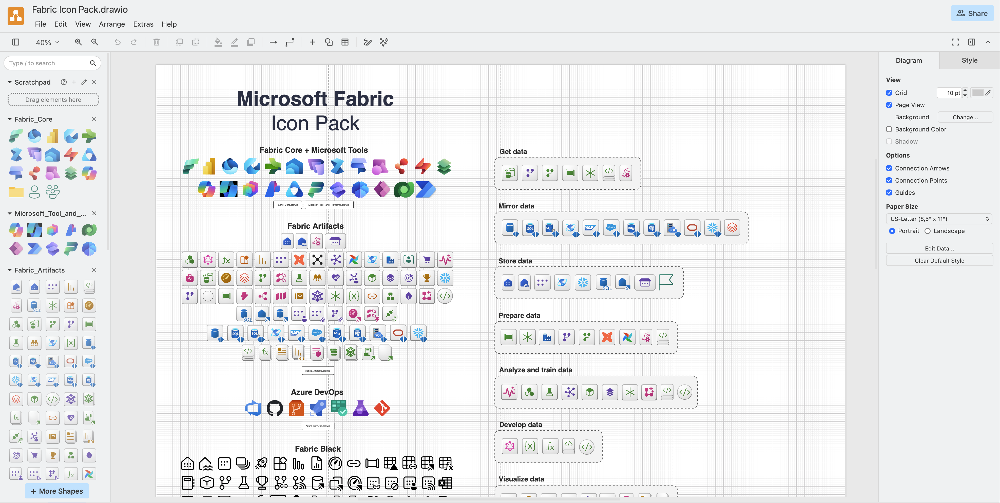
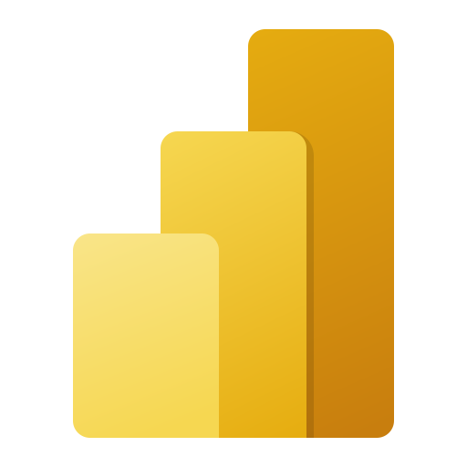
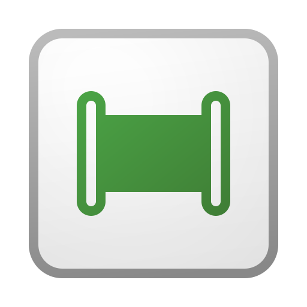
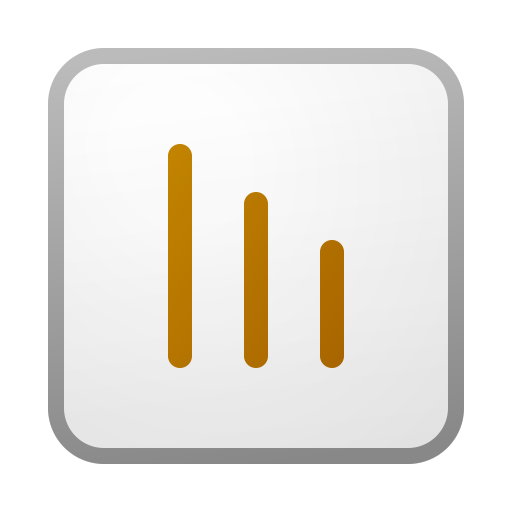
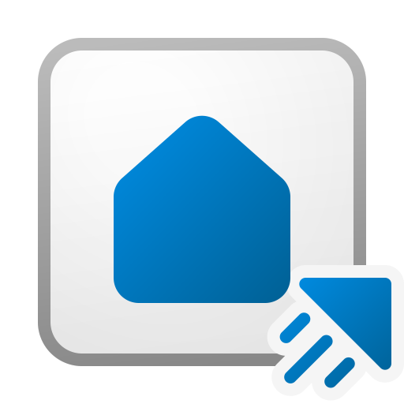
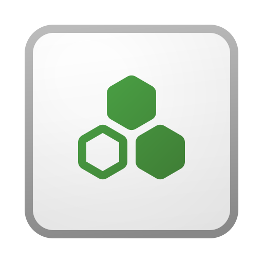

# Microsoft Fabric Icons & Diagramming Library

A ready-to-use collection of **Microsoft Fabric icons, draw.io shape libraries and editable diagram resources** for architecture diagrams, technical documentation and PowerPoint presentations.

**No installation or build step required.** Clone the repository, browse the folders and use the SVG, PNG or draw.io XML files directly.



<sub>Preview image and the curated Fabric & Azure pack by [Andrzej Strzała / FabricToolset](https://github.com/astrzala/FabricToolset), reproduced with attribution. See [sources and licensing notes](docs/REFERENCES.md).</sub>

## Explore Fabric icons

### Workloads and experiences

| :---: | :---: | :---: | :---: |
| [](assets/microsoft/svg/fabric_32_color.svg)<br/>Microsoft Fabric | [](assets/microsoft/svg/power_bi_32_color.svg)<br/>Power BI | [](assets/microsoft/svg/data_factory_32_color.svg)<br/>Data Factory | [](assets/microsoft/svg/data_engineering_32_color.svg)<br/>Data Engineering |
| [](assets/microsoft/svg/data_warehouse_32_color.svg)<br/>Data Warehouse | [](assets/microsoft/svg/data_science_32_color.svg)<br/>Data Science | [](assets/microsoft/svg/real_time_intelligence_32_color.svg)<br/>Real-Time Intelligence | [](assets/microsoft/svg/one_lake_32_color.svg)<br/>OneLake |

### Common architecture building blocks

| :---: | :---: | :---: | :---: |
| [](assets/microsoft/svg/lakehouse_32_item.svg)<br/>Lakehouse | [](assets/microsoft/svg/pipeline_32_item.svg)<br/>Data Pipeline | [](assets/microsoft/svg/notebook_32_item.svg)<br/>Notebook | [](assets/microsoft/svg/dataflow_gen2_32_item.svg)<br/>Dataflow Gen2 |
| [](assets/microsoft/svg/semantic_model_32_item.svg)<br/>Semantic Model | [](assets/microsoft/svg/report_32_item.svg)<br/>Report | [](assets/microsoft/svg/event_house_32_item.svg)<br/>Eventhouse | [](assets/microsoft/svg/data_agent_32_item.svg)<br/>Data Agent |

*Click any icon to open the original vector SVG. For all available sizes and variants, browse the full source folders.*

## Collections

| Collection | What's inside | Open |
| --- | --- | --- |
| **NPM — categorized SVG** | **1,670 SVGs**, arranged by workload, item type and UI function | [Browse by folder](assets/npm/) · [Visual gallery](catalog/README.md) |
| **Microsoft — official icon pack** | **1,584 SVG + 1,584 PNG** from Microsoft's `Icons.zip` | [SVG](assets/microsoft/svg/) · [PNG](assets/microsoft/png/) |
| **FabricToolset — community pack** | **390 original files** (SVGs, draw.io libraries, template and preview images) + bundled license | [Original README & examples](assets/fabrictoolset/README.md) · [SVG collections](assets/fabrictoolset/svg/) |

The collections are separated by **source/provenance**, not presented as identical or interchangeable official releases.

## Import libraries into draw.io

| Library | Use case | Open |
| --- | --- | --- |
| **Official Microsoft** | **16 small XML shape libraries** (at most 40 shapes each), grouped for easier diagrams | [Browse workload libraries](libraries/microsoft/README.md) |
| **FabricToolset community** | Original curated Azure Core, Fabric Core, Artifacts, Datasources, Black and other libraries | [Browse original XML libraries](assets/fabrictoolset/xml/) |
| **Starter template** | Prearranged Fabric architecture icon template | [Open diagram template](assets/fabrictoolset/template/Microsoft%20Fabric%20Icon%20Pack.drawio) |

**Import steps:** Open [diagrams.net](https://app.diagrams.net/) → **File → Open Library from → Device** → select a downloaded `.xml` file. The full [diagramming guide](docs/DIAGRAMMING-GUIDE.md) explains alternative GitHub URL importing, PPT use and best practices.

## Clone the library

```bash
git clone https://github.com/ZeonZheng/fabric-icons.git
```

Until [PR #1](https://github.com/ZeonZheng/fabric-icons/pull/1) is merged, use:

```bash
git clone --branch refactor/organized-icon-catalog https://github.com/ZeonZheng/fabric-icons.git
```

```text
fabric-icons/
├── assets/
│   ├── npm/                  # Categorized NPM SVGs
│   ├── microsoft/            # Official Microsoft SVG + PNG
│   └── fabrictoolset/        # Complete community pack (as published)
├── libraries/
│   └── microsoft/            # Small, ready-to-import draw.io XML libraries
├── catalog/                  # Paginated icon preview galleries
└── docs/                     # Diagramming guide and references
```

This repository is a **static, clone-ready asset snapshot**. There are no checked-in `node_modules`, NPM installation steps, or generation workflows to run.

## Documentation and sources

- [How to use these icons with draw.io and PowerPoint](docs/DIAGRAMMING-GUIDE.md)
- [All original sources, references, attributions and license notes](docs/REFERENCES.md)
- [Microsoft Learn — Fabric icon usage guidance](https://learn.microsoft.com/en-us/fabric/fundamentals/icons)
- [FabricToolset original icon pack](https://github.com/astrzala/FabricToolset/tree/main/Microsoft%20Fabric%20%26%20Azure%20Icon%20Pack)

**Rights:** Product icons and marks are owned by their respective rights holders. The presence of a resource in this repository does not imply unrestricted redistribution or Microsoft endorsement; see [source-specific terms](docs/REFERENCES.md).
